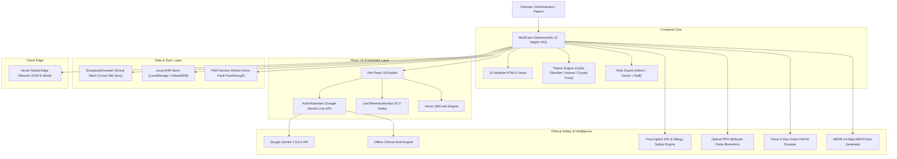

# 🏥 MediCare HMS — Next-Gen AI Healthcare Operations Platform

[](https://hospital-management-system-msz2.vercel.app/)
[](https://react.dev/)
[](https://ai.google.dev/)
[](scripts/deep-verify-hms.js)
[](manifest.json)
[](LICENSE)

---

## 📌 Executive Summary

**MediCare HMS** is an enterprise-grade, full-spectrum Hospital Management Platform engineered for modern clinical workflows. It combines a high-performance **Apple Human Interface Guidelines (HIG) glassmorphism interface** with **embedded React 18 Concurrent Mode widgets**, **real-time Google Gemini Live API medical intelligence**, **computer vision biometrics (Optical PPG)**, **radiology AI scanning**, **WebRTC telemedicine**, **national blood banking**, and **ABDM digital health portability**.

Designed for zero backend deployment friction, MediCare HMS executes all clinical logic, telemetry signal processing, and AI triage on-device in the browser at **60 FPS** with seamless offline resilience.

---

## 🚀 Key Innovations & Clinical Features

### 1. 🤖 Google Gemini Live API & Multilingual Clinical Copilot
- **Live Multimodal Intelligence**: Direct integration with Google's `gemini-1.5-flash` and `gemini-2.0-flash-exp` models.
- **3-Tier Emergency Triage Protocol**:
  - 🔴 **RED Tier (Acute Emergency)**: Instant identification of chest pain, stroke, or severe trauma with emergency hotline alerts (`108` / Trauma Bay STAT).
  - 🟡 **YELLOW Tier (Urgent Care)**: Automatic routing to hospital specialists (Cardiology, Neurology, Orthopedics) with 1-click booking pre-selecting physicians directly in the appointment modal.
  - 🟢 **GREEN Tier (Routine Outpatient)**: Evidence-based self-care and routine consultation recommendations.
- **Multilingual Clinical Voice Synthesis**: Full speech recognition (STT) and voice readout (TTS) supporting **English**, **Hindi (हिंदी)**, and **Telugu (తెలుగు)**.
- **Resilient Offline Copilot**: Instant, deterministic fallback to a local medical rule engine whenever network access is unavailable.

### 2. 🫀 Optical PPG Webcam Pulse Biometrics
- **Non-Contact Vitals Extraction**: Real-time blood volume pulse (BVP) estimation via facial micro-capillary light absorption using standard computer vision on HTML5 Canvas.
- **Dynamic Auto-Gain AC Scaling**: Real-time baseline subtraction and adaptive peak detection delivering stable, non-clipped photoplethysmogram waveforms.
- **Live Clinical Mesh Sync**: Synchronizes measured heart rates directly into inpatient ICU beds and React telemetry monitors.

### 3. 🩻 Radiology AI Chest X-Ray Heatmap Scanner
- **Grad-CAM Opacity Heatmap**: Interactive overlay identifying pulmonary opacities, pneumonia infiltrates, and pleural effusions.
- **Diagnostic Controls**: Real-time opacity threshold slider, clinical preset filters (Normal, Pneumonia, Consolidation, Infiltrate), and manual annotation pen.
- **Printable Radiology Reports**: Instant export of signed diagnostic findings with physician notes.

### 4. 🚑 Live Ambulance GPS Fleet Radar
- **Real-Time Fleet Tracking**: Radar canvas tracking Advanced Life Support (ALS) ambulances across urban zones.
- **Dynamic ETA & Dispatching**: Real-time distance and arrival estimations with emergency dispatch modal and driver call integration.

### 5. 📹 Virtual Telemedicine Cockpit
- **WebRTC Video Consultations**: Real-time hardware-accelerated camera preview for remote patient consultations.
- **Picture-in-Picture Vitals HUD**: Live overlay of patient heart rate, blood pressure, and SpO2 during the video call.
- **In-Call SOAP Clinical Pad**: Simultaneous subjective, objective, assessment, and plan documentation with 1-click prescription and billing handoff.

### 6. 🩸 National Blood Bank & Donor Network
- **8-Blood Group Gauges**: Real-time visual inventory meters for `A+`, `A-`, `B+`, `B-`, `O+`, `O-`, `AB+`, and `AB-`.
- **Donor Eligibility Screening**: Strict algorithmic clinical checks for donor weight ($\ge 50\text{ kg}$), hemoglobin ($\ge 12.5\text{ g/dL}$), and minimum donation intervals ($\ge 90\text{ days}$).
- **STAT Emergency Broadcaster**: Instant cross-tab emergency unit requests broadcasting audible alerts and notification badges.

### 7. 💊 Clinical DDI Engine & Allergy Safety Guard
- **Drug-Drug Adverse Interaction Engine**: Real-time scanning for lethal adverse drug pairs (e.g. Warfarin + Aspirin hemorrhage risk, Sildenafil + Nitrates severe hypotension).
- **Allergy Cross-Reactivity**: Patient profile cross-referencing (e.g. Penicillin hypersensitivity alerts on Amoxicillin orders).
- **Condition Contraindications**: Disease-specific medication warnings (e.g. Dengue fever contraindication with NSAIDs).
- **1-Click Safe Substitutions**: Instant clinician swap to safe alternative medications (e.g. Acetaminophen).

### 8. 🪪 Ayushman Bharat (ABDM) 14-Digit ABHA Health ID
- **National Health Stack Compliance**: Generation of compliant 14-digit ABHA IDs (`91-XXXX-XXXX-XXXX`) and formatted ABHA addresses (`name@abdm`).
- **Verifiable Vector QR Code**: High-precision SVG QR code rendering with dynamic age-derived date of birth.
- **Apple Wallet Export**: 1-Click download of compliant Apple Wallet digital passes (`.pkpass.json`) and printable SVG cards.

### 9. 🛏️ Interactive 2D/3D Bed Floor Plan
- **Hospital Ward Visualizer**: Real-time status mapping across ICU, CCU, Pediatrics, Emergency, General Ward, and Private Suites.
- **Bidirectional Inpatient Sync**: Direct 1-click bed allocation and discharge seamlessly syncing patient admission records and billing status.

### 10. ⚡ Distributed BroadcastChannel Clinical Mesh
- **Cross-Tab Real-Time Mesh**: Multi-window synchronization using HTML5 `BroadcastChannel` with bounded event deduplication and persistent session identifiers.
- **Instant Reactive Updates**: Changes made in Emergency, Laboratory, or Pharmacy reflect instantly across the Executive Dashboard without refreshing.

---

## 🏗️ System Architecture



---

## 🗂️ Complete 15-Page Module Directory

| # | File | Clinical Purpose | Key Highlights |
|---|---|---|---|
| 1 | `index.html` | Secure Glass Portal & Login | 3 core personas (Admin, Doctor, Staff), slides link |
| 2 | `dashboard.html` | Executive Operations Cockpit | 7-day patient flow, bed occupancy donut, live KPIs |
| 3 | `emergency.html` | Emergency & Trauma Care | Real Optical PPG sensor, ICU telemetry, ambulance radar |
| 4 | `telemedicine.html` | Virtual Telehealth Cockpit | WebRTC video feed, vitals HUD, in-call SOAP notes |
| 5 | `blood-bank.html` | National Blood Network | 8 inventory gauges, donor intake screening, STAT broadcast |
| 6 | `patients.html` | Patient Directory & EHR | Medical history timeline, ABHA 14-digit pass generator |
| 7 | `doctors.html` | Medical Staff & Rosters | Departmental profiles, weekly consultation schedules |
| 8 | `appointments.html` | Clinical Appointment Engine | List & interactive calendar views, 1-click specialist booking |
| 9 | `prescriptions.html` | Digital Prescription Pad | DDI interaction engine, allergy guards, verifiable QR codes |
| 10 | `laboratory.html` | Diagnostic Pathology & Radiology | Chest X-ray AI Grad-CAM scanner, lab test ordering |
| 11 | `pharmacy.html` | Formulary & Inventory | Drug batch management, stock alerts, dispensing flow |
| 12 | `billing.html` | Invoicing & Revenue Cycle | Auto-calculated taxes, discount codes, printable tax receipts |
| 13 | `admin.html` | Administrative Controls | Smart 2D/3D bed floor plan, system audit logs, backups |
| 14 | `patient-portal.html` | Patient Self-Service Portal | Personal EHR access, upcoming appointments, ABHA wallet |
| 15 | `slides.html` | Interactive Pitch Deck | 18 modern presentation slides with live deck controls |

---

## 💻 Local Development & VS Code Quickstart

### Prerequisites
- [Node.js](https://nodejs.org/) (v18.0.0 or higher recommended)
- Modern web browser (Google Chrome, Microsoft Edge, Mozilla Firefox, or Apple Safari)

### 1. Clone & Install
```bash
git clone https://github.com/Udaykiranjammula-alpha/hospital-management-system.git
cd hospital-management-system
npm install
```

### 2. Run Locally
```bash
npm start
```
*Launches local zero-latency HTTP server at `http://localhost:3000` (or `http://localhost:8080`).*

### 3. Run Deep Automated Verification Suite
```bash
npm test
```
*Executes all **213 automated tests** across 16 clinical and architectural test suites.*

### 4. Rebuild React 18 Bundle (Optional)
```bash
npm run build:react
```
*Compiles embedded React 18 widgets into `js/react-components.bundle.js` in ~100ms via Vite.*

---

## 🌐 Production Deployment

The platform is configured for continuous zero-downtime deployment on the **Vercel Edge Network**:

- **Production URL**: [https://hospital-management-system-msz2.vercel.app/](https://hospital-management-system-msz2.vercel.app/)
- **Configuration**: `vercel.json` with direct internal server rewrites, clean caching headers, and Edge CDN caching.
- **Service Worker**: Zero-Fault Service Worker v2.1 with pure browser navigation passthrough preventing redirect collisions or `ERR_FAILED` issues.

---

## 👥 Hackathon Presentation Team

- **Lead**: NISTALA SAI VENKATA ABHIRAM
- **Members**:
  - GANGADHAR
  - UDAY KIRAN
  - MADAN
- **Mentor**: PROF. KISHORE RAJU

---

## 📄 License

This project is licensed under the **MIT License** — see the [LICENSE](LICENSE) file for details.  
Copyright © 2026 MediCare Super Specialty Hospital. All Rights Reserved.
